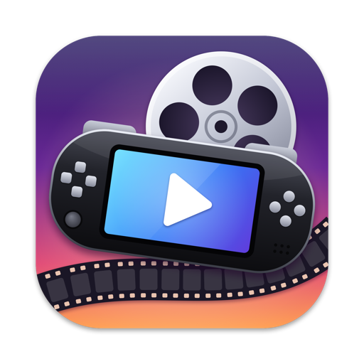

# PSP Video Prep

A native macOS app that converts videos into files a Sony PSP will actually play, with thumbnails for the PSP's video menu.

Drop in almost any video — MP4, MOV, MKV, AVI (DivX/Xvid), WMV, FLV, MPEG and more — and get back a PSP-ready `.mp4` plus a matching `.THM` thumbnail. Everything needed is inside the app; there is nothing else to install.

The code for PSP Video Prep was written by Claude Fable 5.2, Anthropic's AI model. If you are not comfortable with AI-written code, this is not a project for you.

## Features

- **Made for the PSP's player** — 480×272 H.264 (Main profile, level 3.0) with AAC stereo audio, at a constant frame rate, in the Sony `MSNV` flavour of MP4 the PSP expects. Confirmed playing on a real PSP running firmware 6.61.
- **Batch conversion** — queue any number of videos, or drop a whole folder (subfolders included), and convert them in one go.
- **Almost any input** — formats macOS can read are handled directly; everything else goes through a bundled copy of FFmpeg.
- **Memory-stick friendly** — save straight to the PSP's `VIDEO` folder. The app removes the hidden `._` files macOS leaves on memory sticks, which the PSP would otherwise list as corrupted videos.
- **Thumbnails** — each video gets a 160×120 thumbnail for the PSP's video list. Pick from six frames, export one on its own, or choose no thumbnail.
- **Quality and scaling choices** — three quality levels (Standard is roughly 5.5 MB per minute), and fit, fill or stretch for video that isn't the PSP's shape.

## Download

Grab `PSP Video Prep.app` from the [Releases](../../releases) page. The app is signed and notarized, so it runs out of the box on both Apple Silicon and Intel Macs. Requires macOS 26.5 or later.

## Usage

1. Launch the app and drop videos or folders anywhere on the window.
2. Optionally click a thumbnail to choose a different frame, and pick a quality and scaling.
3. Hit **Convert**, and choose where to save the results.
4. Copy each `<name> (PSP).mp4` and its `<name> (PSP).THM` into the `VIDEO` folder on your PSP's memory stick.

## Building

1. Run `scripts/build-ffmpeg.sh` once. It downloads the official FFmpeg source, verifies its checksum and builds the helper the app bundles (Apple Silicon and Intel). This needs only Xcode's command line tools and takes a few minutes. Without it the app still builds, but can only read formats macOS supports natively.
2. Open `psp_video_prep.xcodeproj` in Xcode and build the *psp_video_prep* target.

No package dependencies. The project has no development team configured — select your own team under *Signing & Capabilities* (or leave it empty and sign to run locally).

## Legal

This project contains no video content. Use it only with videos you have the right to convert.

"PlayStation" and "PSP" are trademarks of Sony Interactive Entertainment; this project is not affiliated with or endorsed by Sony.

## Credits

- [FFmpeg](https://ffmpeg.org) (LGPL-2.1-or-later) — bundled as a separate program and used only to read formats macOS can't open. The build is unmodified, enables no GPL or non-free components, and is produced by `scripts/build-ffmpeg.sh`. Its licence and notice ship inside the app (`psp_video_prep/Helpers/`).
- The FFmpeg project's PSP muxer, whose source documents the Sony-specific parts of the PSP's MP4 format that this app writes.

## License

MIT — see [LICENSE](LICENSE). The bundled FFmpeg remains under its own licence, the LGPL.
